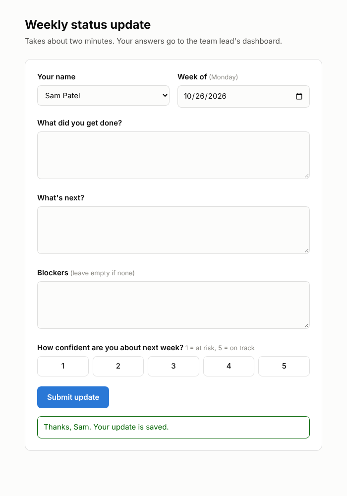
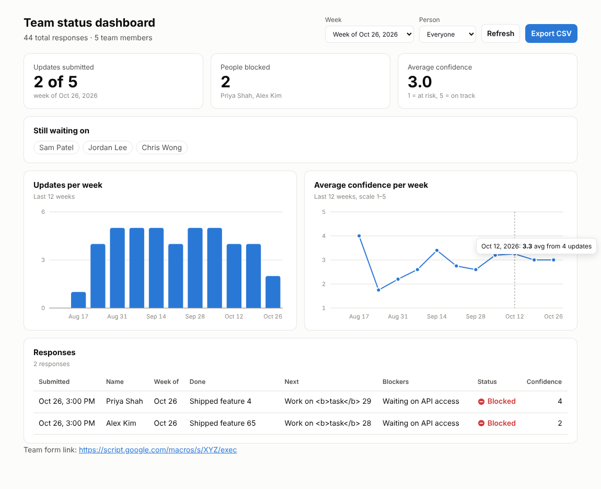

# Team Status Updates

A small app for collecting weekly status updates from your team. It runs on
Google Apps Script, and every response is saved as a row in a Google Sheet you own.

- **Form**: your team picks their name and fills in *Done*, *Next*, *Blockers* and a 1–5 confidence rating.
- **Dashboard**: shows who has and hasn't submitted, who is blocked, average confidence,
  charts by week, a full table of responses, and a CSV export.
- **Google Sheet**: holds the raw data. Use *File → Download → Microsoft Excel* there to get an Excel file.

| Form | Dashboard |
|---|---|
|  |  |

## Setup (about 10 minutes, no coding)

1. **Create the Sheet.** Go to <https://sheets.new> and name it, e.g. "Team Status Updates".
2. **Open the script editor.** In the Sheet, go to **Extensions → Apps Script**.
3. **Copy in the code.**
   - Replace the contents of `Code.gs` with [`src/Code.gs`](src/Code.gs).
   - Click **+ → HTML**, name it `Form`, and paste [`src/Form.html`](src/Form.html).
   - Click **+ → HTML**, name it `Dashboard`, and paste [`src/Dashboard.html`](src/Dashboard.html).
   - Click **Save**.
4. **Create the tabs.** In the function menu at the top choose `setup`, then click **Run**.
   Approve the permissions prompt. Your Sheet now has an **Updates** tab and a **Team** tab.
5. **Add your team.** In the **Team** tab, replace the example names in column A with your
   team members' names, one per row below the header.
6. **Publish.** Click **Deploy → New deployment**. Choose type **Web app** and set:
   - *Execute as*: **Me**
   - *Who has access*: **Anyone** (or **Anyone within your organization** on Google Workspace)

   Click **Deploy** and copy the **Web app URL**.
7. **Share.**
   - **Send this to your team:** the Web app URL.
   - **Keep this for yourself:** the same URL with `?page=dashboard` on the end.

## Protecting the dashboard (recommended)

Anyone who knows the dashboard link can see the responses. To add a password:

1. In Apps Script, open **Project Settings (gear icon) → Script properties → Add property**.
2. Set the property to `DASHBOARD_KEY` and the value to a long random string.
3. Open your dashboard at `<Web app URL>?page=dashboard&key=<that string>`.

The form keeps working without the key.

## Changing things later

- **Add or remove people:** edit the **Team** tab. No redeploy needed.
- **Change the code:** after editing, go to **Deploy → Manage deployments → Edit (pencil) →
  Version: New version → Deploy**. This keeps the same URL.
- **Weekly reminder (optional):** in Apps Script, open **Triggers (clock icon)** and add a
  time-driven trigger, or simply post the form link in your team chat every Friday.

## Files

| File | Purpose |
|---|---|
| `src/Code.gs` | Server code: serves pages, validates and saves submissions, reads data for the dashboard |
| `src/Form.html` | The status update form |
| `src/Dashboard.html` | Dashboard with KPIs, charts, response table and CSV export |
| `src/appsscript.json` | Apps Script manifest, used only if you deploy with the `clasp` command-line tool |

## Notes

- If someone submits twice for the same week, both rows are kept in the Sheet and table.
  The dashboard counts, charts and "blocked" figures use only their latest submission.
- Text that starts with `=`, `+`, `-` or `@` is stored as plain text, so it can't run as a formula in Sheets or Excel.
